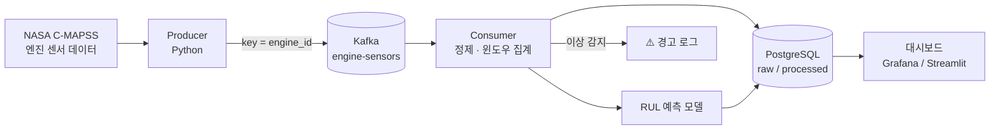

# ✈️ AeroPulse — 항공기 엔진 예지정비 실시간 데이터 파이프라인

> 항공기 엔진 센서 데이터를 **실시간으로 수집·처리**해 고장 징후를 미리 감지하고,
> 엔진별 **잔여 수명(RUL, Remaining Useful Life)** 을 예측하는 데이터 파이프라인


---

## 📌 1. 프로젝트 배경

| 기존 정비 방식 | 문제점 |
|---|---|
| 사후 정비 (고장 후 수리) | 예상치 못한 결항·지연, 안전 리스크 |
| 예방 정비 (정해진 주기마다 교체) | 멀쩡한 부품도 교체 → 비용 낭비 |
| **예지 정비 (데이터 기반 예측)** | **필요한 시점에만 정비 → 안전 + 비용 절감** |

실제 항공사들은 엔진·센서·정비 이력 데이터를 통합한 플랫폼(예: Airbus Skywise)으로
예지정비를 운영하고 있다. 이 프로젝트는 그 핵심인 **"센서 데이터가 끊김 없이, 정확하게,
실시간으로 흐르는 구조"** 를 직접 설계·구현해보는 것을 목표로 한다.

## 🎯 2. 목표

- [ ] 엔진 100대의 센서 데이터를 Kafka로 **실시간 스트리밍**
- [ ] 수신 데이터를 정제해 PostgreSQL에 **원본/가공 계층 분리 저장**
- [ ] 이동평균 기반 **열화 이상 감지 및 경고**
- [ ] 학습된 모델로 **실시간 RUL 예측**
- [ ] 대시보드로 엔진별 상태 **시각화**

---

## 🏗️ 3. 아키텍처



| 구성 요소 | 역할 |
|---|---|
| Producer | C-MAPSS 데이터를 사이클 순서대로 재생 → 실제 비행처럼 실시간 전송 |
| Kafka | 센서 메시지 버퍼 · 엔진 ID 기준 파티셔닝으로 순서 보장 |
| Consumer | 결측/이상값 처리, 엔진별 슬라이딩 윈도우 집계, 이상 감지 |
| PostgreSQL | 원본(raw) / 가공(processed) / 예측(prediction) 테이블 분리 |
| 대시보드 | 엔진별 센서 추이, RUL, 경고 현황 |

---

## 🛠️ 4. 기술 스택

| 분류 | 기술 | 선택 이유 |
|---|---|---|
| Language | Python 3.11 | 데이터 처리·ML 생태계 |
| Streaming | Apache Kafka (KRaft) | 대용량 실시간 메시지 처리, ZooKeeper 불필요 |
| Infra | Docker Compose | 여러 서비스를 한 번에 재현 가능하게 실행 |
| Storage | PostgreSQL | 시계열 + 관계형 조회, SQL 분석 |
| ML | scikit-learn → PyTorch(LSTM) | 베이스라인 → 시계열 딥러닝 |
| Visualization | Grafana / Streamlit | 실시간 모니터링 |

---

## 📊 5. 데이터셋

**NASA C-MAPSS (Turbofan Engine Degradation Simulation)**

- 터보팬 엔진이 정상 상태에서 고장까지 열화되는 과정을 시뮬레이션한 다변량 시계열
- 컬럼: `엔진 ID, 사이클, 운항 조건 3개, 센서 21개`
- 서브셋: FD001 ~ FD004 (본 프로젝트는 **FD001**부터 시작)
- 데이터는 저장소에 포함하지 않음 → NASA Prognostics Data Repository에서 받아 `data/`에 넣기
- 확장 예정: N-CMAPSS (상승·순항·하강 전체 비행 구간 포함)

---

## 📁 6. 디렉토리 구조

```
aeropulse/
├── docker-compose.yml
├── requirements.txt
├── data/                  # 원본 데이터 (gitignore)
├── notebooks/
│   └── 01_eda.ipynb       # 센서별 열화 패턴 분석
├── producer/
│   └── engine_producer.py
├── consumer/
│   └── engine_consumer.py
├── db/
│   └── schema.sql
├── model/
│   ├── train.py
│   └── predict.py
├── dashboard/
└── docs/
    └── decisions.md       # 설계 결정 기록
```

---

## 🚀 7. 실행 방법

```bash
# 1. 저장소 클론
git clone https://github.com/jaehyuck46-cyber/aeropulse.git
cd aeropulse

# 2. 가상환경 생성 및 패키지 설치
python -m venv .venv
.venv\Scripts\activate          # macOS/Linux: source .venv/bin/activate
pip install -r requirements.txt

# 3. 데이터 준비
# NASA Prognostics Data Repository에서 C-MAPSS FD001을 받아 data/ 에 넣는다
#   data/train_FD001.txt, data/test_FD001.txt, data/RUL_FD001.txt

# 4. 인프라 실행 (Kafka)
docker compose up -d

# 5. 토픽 생성 (최초 1회)
docker exec kafka /opt/kafka/bin/kafka-topics.sh \
  --bootstrap-server localhost:9092 \
  --create --topic engine-sensors --partitions 3

# 6. Producer 실행
python producer/engine_producer.py --max-cycles 10   # 테스트: 10사이클
python producer/engine_producer.py                   # 전체: 362사이클 (약 3분)
```

인프라 종료: `docker compose down`

---

## 🗺️ 8. 로드맵

| 단계 | 내용 | 상태 |
|---|---|---|
| Phase 0 | 목적 정의 · README 작성 | ✅ |
| Phase 1 | EDA — 열화를 잘 보여주는 센서 선별 | ✅ |
| Phase 2 | Kafka Producer / Consumer 구현 | 🔄 Producer 완료 |
| Phase 3 | PostgreSQL 스키마 설계 · 저장 | ⬜ |
| Phase 4 | 이상 감지 로직 + 에러 처리 / 재시도 | ⬜ |
| Phase 5 | RUL 모델 학습 (RandomForest → LSTM) | ⬜ |
| Phase 6 | 실시간 RUL 예측 연동 | ⬜ |
| Phase 7 | 대시보드 | ⬜ |
| Phase 8 | 확장: N-CMAPSS / OpenSky 실시간 비행 데이터 연동 | ⬜ |

---

## 🧠 9. 설계 결정 (Why?)

> 구현하면서 "왜 이렇게 했는지"를 기록한다. 자세한 내용은 `docs/decisions.md`

| 결정 | 이유 |
|---|---|
| 메시지 key를 엔진 ID로 지정 | 같은 엔진 데이터는 같은 파티션 → 시계열 순서 보장 |
| raw / processed 테이블 분리 | 가공 로직이 바뀌어도 원본으로 재처리 가능 |
| 센서 21개 중 14개만 전송 | EDA 결과 7개는 값이 변하지 않음 → 전송량·저장량 약 1/3 절감 |
| Kafka를 KRaft 모드로 실행 | ZooKeeper가 필요 없어 컨테이너 1개로 구성 가능 |
| Docker 이미지·패키지 버전 고정 (`apache/kafka:4.1.0`, `kafka-python==3.0.13`) | `latest`는 시점에 따라 동작이 달라져 재현성이 깨짐 |
| 사이클 단위로 묶어 전송 (엔진별 순차 아님) | 엔진 100대가 동시에 운항하는 실제 상황을 재현 |
| 전송 주기를 인자(`--max-cycles`)로 제어 | 코드 수정 없이 테스트(10사이클)와 전체 실행을 전환 |
| Kafka에 volume 미설정 | 개발 단계에서는 `down`→`up`으로 초기화하는 편이 디버깅에 유리. 영속성이 필요해지는 Phase 3에서 추가 |

---

## 🐛 10. 트러블슈팅 기록

| 문제 | 원인 | 해결 |
|---|---|---|
| 파티션이 3개일 때 같은 엔진의 센서 데이터가 여러 파티션으로 흩어져 시계열 순서가 깨질 수 있음 | Kafka는 순서를 파티션 단위로만 보장하는데, key가 없으면 메시지가 파티션에 분산 배치됨 | 메시지 key를 엔진 ID로 지정. `kafka-console-consumer.sh --property print.partition=true`로 엔진 1·5 → 파티션 0, 엔진 2·50 → 파티션 2에 항상 고정됨을 확인 |
| 표준편차가 작은 센서를 수치만 보고 제외할 뻔함 (s15: 0.0375) | 센서마다 측정 단위와 값의 크기가 달라, 표준편차 절댓값만으로는 유용성을 판단할 수 없음 | RUL 대비 추세 그래프를 함께 확인 → s15는 뚜렷한 상승 추세를 보여 사용 센서로 채택 (상관 0.64) |

---

## 📈 11. 결과

### Phase 1 — EDA ([notebooks/01_eda.ipynb](notebooks/01_eda.ipynb))

| 구분 | 센서 | 근거 |
|---|---|---|
| ✅ 사용 (14개) | s2, s3, s4, s7, s8, s9, s11, s12, s13, s14, s15, s17, s20, s21 | 고장이 가까워질수록 값이 뚜렷하게 변함 |
| ❌ 제외 (7개) | s1, s5, s6, s10, s16, s18, s19 | 값이 거의 변하지 않음 (RUL 상관관계 NaN 또는 0.13) |

**주요 발견**
1. 엔진 수명이 **128 ~ 362 사이클로 약 3배 차이** → 고정 주기 정비의 한계, 엔진별 예측 필요
2. 표준편차가 작아도 유용한 센서가 있음 (s15) → 수치만이 아니라 그래프로 반드시 확인
3. 센서 값은 RUL 약 100까지 안정적이다가 이후 급격히 변함 (비선형) → RUL 상관계수가 최대 0.70에 머무는 이유
4. s9, s14는 엔진마다 열화 방향이 달라 상관관계가 낮음 (0.39, 0.31) → 모델 단계에서 포함 여부 비교 예정

### Phase 2 — Kafka Producer ([producer/engine_producer.py](producer/engine_producer.py))

- Kafka 4.1.0 단일 브로커(KRaft) 구성, 토픽 `engine-sensors` 파티션 3개
- C-MAPSS FD001을 사이클 순서로 재생해 엔진 100대의 동시 운항을 재현 (362사이클 × 0.5초 ≈ 3분)
- 센서 14개만 JSON으로 직렬화해 전송, 메시지 key = 엔진 ID
- **검증**: 10사이클(1,000건) 전송 후 Consumer 수신 확인, key별 파티션 고정 확인

_(Phase 5 이후 추가 — 모델 성능 RMSE, 대시보드 스크린샷 등)_

---

## 💡 12. 배운 점

_(프로젝트 완료 후 작성)_

---

## 🔗 관련 프로젝트

- [김포공항 항공편 지연 데이터 파이프라인](https://github.com/jaehyuck46-cyber/flight-delay-pipeline) — 배치 처리
- **AeroPulse** — 실시간 스트리밍 처리

---

**Author** · 신재혁 (한서대학교 항공 AI 소프트웨어공학과)
